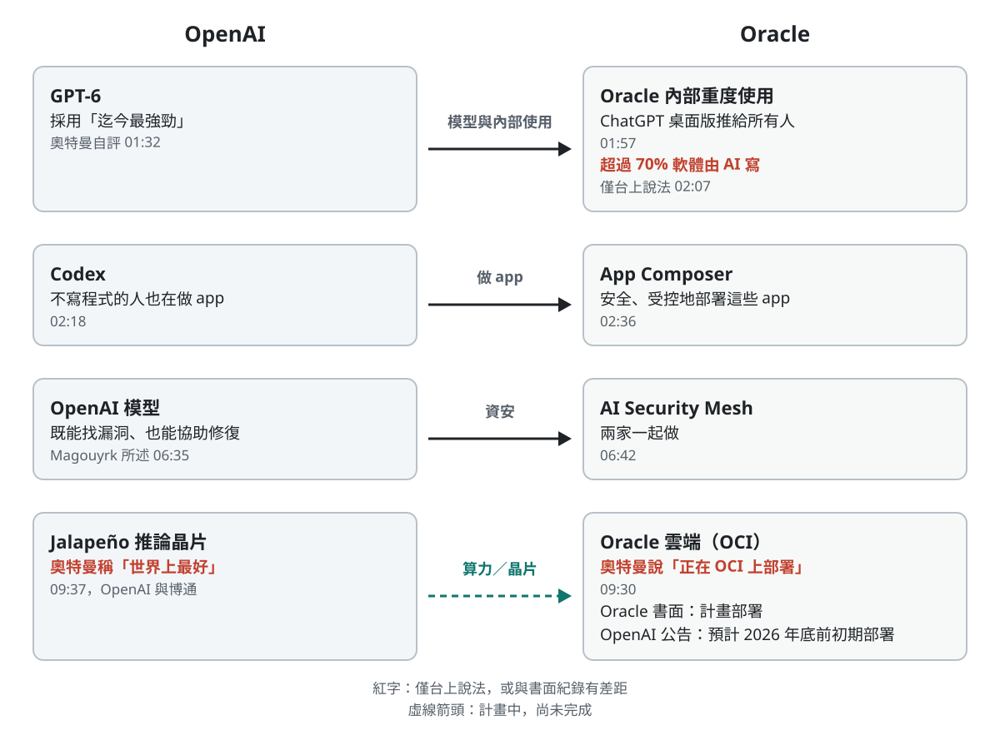

# 台上十分鐘，紙上四項產品：奧特曼與 Oracle 執行長 Magouyrk 的 AI World 對談

*圖說：AI 生成的概念插畫，比喻台上的對談與台後撐著它的基礎設施，不是活動現場照片。*

> 這是一篇導讀：先給重點與查證，再逐段看台上說了什麼、哪些要對照書面公告讀。本導讀的分析與撰稿由 AI 模型完成，不是人類分析，也沒有經過人工逐句校稿，見文末〈製作說明〉。

這支影片是 CNBC 上傳的 10 分 36 秒節錄，取自 Oracle AI World 2026 的主題演講，不是整場演講。上台的是 OpenAI 執行長山姆・奧特曼（Sam Altman），主持對談的是 Oracle 執行長 Clay Magouyrk；Oracle 由 Magouyrk 與 Mike Sicilia 兩位執行長並列，官方頁面有時稱 CEO、有時稱 co-CEO（[Oracle AI World](https://www.oracle.com/ai-world/)、[Oracle 投資人關係](https://investor.oracle.com/investor-news/news-details/2026/Oracle-Investor-Day-2026-Accelerating-Value-Creation/default.aspx)）。

同一天，Oracle 發出新聞稿，宣布與 OpenAI 擴大合作，四項新產品把 ChatGPT 與 Codex 帶進 Oracle 的應用、資料與雲端（[Oracle 新聞稿](https://www.oracle.com/news/announcement/ai-world-oracle-reinvents-enterprise-computing-for-the-ai-era-with-openai-2026-10-27/)）。台上十分鐘只點名了其中兩項，其餘時間在談模型變快、人人都能做軟體、資安與晶片。

這種場合的話要對照書面才讀得準，所以本文把台上的說法逐項對回書面公告，標出哪些找得到，哪些只是台上說法。

## 三十秒版

- 這是 CNBC 節錄的主題演講對談。兩人是合作夥伴，整段幾乎沒有不同意見。
- **台上有兩處跟書面紀錄對不上**：GPT-6 的推出月份，Magouyrk 說 8 月，官方發表頁標 9 月；奧特曼說 Jalapeño 晶片「正在 OCI 上部署」，Oracle 自己的寫法是「計畫部署」，用來擴充 OpenAI 自己的推論容量。
- Magouyrk 台上說 Oracle 超過 70% 的軟體由 AI 撰寫，只有這一句，沒有公布怎麼算。OpenAI 公布的是另一組數字：Oracle 有 13 萬名 ChatGPT 活躍使用者、超過 9.5 萬名 Codex 活躍使用者，並注明數字由 Oracle 提供。
- 最值得帶走的一句是奧特曼的建議：短期內如果只能做一件事，**比用 Codex 變得超級有生產力更重要的，是理解 AI 帶來的資安威脅並做防範**。

## 先看重點：台上的說法，查得到什麼

狀態欄的意思：「與書面不符」是官方日期或說法跟台上不同；「書面已確認」是官方頁面支持；「用詞比書面更進一步」是台上的動詞比書面強；「僅台上說法」是講者自述，沒有可對照的公開數字。

| 台上的說法 | 書面紀錄 | 狀態 |
|---|---|---|
| 「你們在 8 月推出了 GPT-6」（00:42，Magouyrk） | 官方發表頁標的是 9 月 | 與書面不符 |
| GPT-6 的採用是所有新模型中迄今最強勁的（01:32，奧特曼） | 查無 OpenAI 公布的 GPT-6 專屬採用數字 | 僅台上說法 |
| Oracle 把 ChatGPT 桌面版推給所有人（01:57，Magouyrk） | OpenAI 客戶案例：13 萬 ChatGPT、9.5 萬以上 Codex 活躍使用者，數字由 Oracle 提供；案例未提桌面版全員推行 | 僅台上說法 |
| 超過 70% 的軟體由 AI 撰寫（02:07，Magouyrk） | 沒有 70% 這個數字；沒有公布算法 | 僅台上說法 |
| 為了讓大家安全部署自己做的 app，所以做 App Composer（02:36，Magouyrk） | Oracle：App Composer 讓使用者用 Codex 建應用、由 Oracle 在 OCI 上部署與營運；截至 10 月 27 日為限量供應 | 書面已確認 |
| 一起打造 AI Security Mesh（06:42，Magouyrk） | Oracle：使用 OpenAI 資安模型的託管服務，由客戶界定授權測試範圍；產品頁未寫上市日期 | 書面已確認 |
| Jalapeño 晶片「正在 OCI 上部署」（09:30，奧特曼） | OpenAI 6 月 24 日發表，預計 2026 年底前啟動初期部署；Oracle 寫的是「計畫部署」，用來擴充 OpenAI 的推論容量 | 用詞比書面更進一步 |
| Jalapeño 是「世界上最好的推論用 AI 晶片」（09:37，奧特曼） | OpenAI 公告只說早期測試每瓦效能大幅優於目前最先進水準，仍在測量最終效能 | 僅台上說法 |

## 這場對談談到哪四件合作

*圖說：本文歸納，非講者原圖。內容限於台上談到的合作；紅字是僅台上說法或與書面紀錄不同之處，虛線箭頭是計畫中、尚未完成的事。*

圖裡四條線是模型（GPT-6）、Oracle 內部用 Codex 做 app（連到 App Composer）、資安（AI Security Mesh）和晶片（Jalapeño）。其中晶片是計畫中，資安的上市日期書面沒寫。

## 一、GPT-6：模型一口氣跨一大步

Magouyrk 的第一個問題是：「你們在 8 月推出了 GPT-6」（[00:42](https://www.youtube.com/watch?v=SwoFsYmMvyA&t=42s)），「目前進展如何？」官方發表頁標的是 9 月（[OpenAI](https://openai.com/index/gpt-6-astra/)）。

奧特曼的回答從速度講起。「今年對我來說最大的驚喜之一，就是這種變化的速度」（[00:46](https://www.youtube.com/watch?v=SwoFsYmMvyA&t=46s)）。「4 年前，我們的模型連小學數學都解不出來，而現在它們正在攻克我們所知最難的、尚未被證明的數學問題」（[00:57](https://www.youtube.com/watch?v=SwoFsYmMvyA&t=57s)），而過去大概 6 個月，即使放在這四年裡看，也像是非常加速的版本。

他說 GPT-6 是模型「一口氣跨出了一大步」的時刻之一（[01:12](https://www.youtube.com/watch?v=SwoFsYmMvyA&t=72s)），一方面是模型能發現新知識、處理很難的事，另一方面是人們跟模型協作、完成大量實質工作的速度變快了。他的結論是：「所以，GPT-6 的採用是我們所有新模型中迄今最強勁的，遙遙領先」（[01:32](https://www.youtube.com/watch?v=SwoFsYmMvyA&t=92s)）。OpenAI 沒有公布 GPT-6 專屬的採用數字可以對照，這句只能當執行長的評價讀。

## 二、Oracle 內部：70% 與 13 萬人

接下來 Magouyrk 講自家。「在 Oracle 內部，我們顯然是 OpenAI 的重度使用者」（[01:50](https://www.youtube.com/watch?v=SwoFsYmMvyA&t=110s)），「我們決定把 ChatGPT 桌面版推行給所有人」（[01:57](https://www.youtube.com/watch?v=SwoFsYmMvyA&t=117s)）。然後是整段最具體的數字：「我們絕大多數的程式碼，如今超過 70% 的軟體都是由 AI 寫的，而且這還在加速」（[02:07](https://www.youtube.com/watch?v=SwoFsYmMvyA&t=127s)）。

**這個 70% 只有台上一句。**台上沒說怎麼算，Oracle 的新聞稿與合作頁也沒有這個數字。

書面上找得到的是另一組數字。OpenAI 10 月 8 日的客戶案例寫，Oracle 有 13 萬名 ChatGPT 活躍使用者、超過 9.5 萬名 Codex 活躍使用者，從人才招募、Oracle Applications Lab 到 IT 部門已有超過十萬名員工在用（[OpenAI 客戶案例](https://openai.com/index/oracle/)）；10 月 27 日的合作公告重述這兩個數字，並注明由 Oracle 提供（[OpenAI](https://openai.com/index/oracle-apps-in-chatgpt/)）。案例裡最醒目的例子是招募團隊：原本要花 2 至 4 天彙整的市場研究，現在準備約 15 到 20 分鐘。

> 注意：13 萬與 9.5 萬是「活躍使用者」，不等於全員都裝了桌面版，也不是 70% 的佐證。三個數字量的是不同的東西。

## 三、不寫程式的人也在做 app

Magouyrk 接著說，讓他驚訝的不只是 Codex，還有「誰算是開發者」這件事在改變。他去交談過的許多人，「幾年前他們根本無法想像自己會成為開發者」（[02:18](https://www.youtube.com/watch?v=SwoFsYmMvyA&t=138s)），現在卻在做全新的應用程式。他把這連到自家產品：「這也是我們專注於打造 App Composer 的很大一部分原因」（[02:36](https://www.youtube.com/watch?v=SwoFsYmMvyA&t=156s)），因為這麼多人在做新的 app，「我們需要一種安全且受控的方式來實際部署它們」（[02:40](https://www.youtube.com/watch?v=SwoFsYmMvyA&t=160s)）。

奧特曼的回答幾乎是同一個觀察。企業全面推行之後，那些不認為自己在創造軟體的人，「這種情況在整家公司裡擴散得有多快」（[03:26](https://www.youtube.com/watch?v=SwoFsYmMvyA&t=206s)）。「所以你會看到這些人，他們可能不會將其描述為寫程式」（[03:30](https://www.youtube.com/watch?v=SwoFsYmMvyA&t=210s)），但現在需要什麼，就自己做一個 app。他轉述常聽到的說法：生產力是 2025 年初的兩倍，也更享受工作，因為苦差事變少了。

兩人接著各講自己的經驗。Magouyrk 說他曾經算是個軟體開發者，當初讓他著迷的是「我能有一個想法，而且我能把它變成現實」（[04:32](https://www.youtube.com/watch?v=SwoFsYmMvyA&t=272s)），可是這種創造性跟怎麼向電腦下指令，是分開的兩件事；AI 把手動的部分自動化，替原本不往這方面走的人解鎖了創造力。奧特曼說「我強烈同意這一點」，也補了另一半：對本來就更傾向這方面的人，「它只是給你多得多的能力」（[05:07](https://www.youtube.com/watch?v=SwoFsYmMvyA&t=307s)）。

他的自我描述是整段最有畫面的一句：「我現在坐在電腦前使用最新工具的主觀體驗，就像是我在自己的電腦裡管理一座工廠」（[05:14](https://www.youtube.com/watch?v=SwoFsYmMvyA&t=314s)）。以前只有模糊感覺、「平時我大概就會放棄」的點子（[05:41](https://www.youtube.com/watch?v=SwoFsYmMvyA&t=341s)），現在因為啟動門檻變低，「我願意去探索這些不太可能、但有時回報很大的創意方向」（[05:47](https://www.youtube.com/watch?v=SwoFsYmMvyA&t=347s)）。

這一段的兩個說法放在一起看，才看得出 Oracle 的產品邏輯：人人都能做 app 之後，接著的問題是這些 app 誰來管。奧特曼談的是個人：誰都能把想法變成 app。Magouyrk 談的是企業的下一步：這麼多 app 要有地方安全地跑。Oracle 對 App Composer 的書面描述，重點也在後者：連到經核准的 Oracle 資料與流程，並套用企業的身分、權限、網路、稽核與應用程式生命週期控管（[Oracle 新聞稿](https://www.oracle.com/news/announcement/ai-world-oracle-reinvents-enterprise-computing-for-the-ai-era-with-openai-2026-10-27/)）。Oracle 部落格寫，App Composer 目前是限量供應（Limited Availability）（[Oracle 部落格](https://blogs.oracle.com/cloud-infrastructure/announcing-oracle-app-composer)）。

## 四、資安：如果只能做一件事

「好吧，聽著，我們有時間限制，山姆」（[06:27](https://www.youtube.com/watch?v=SwoFsYmMvyA&t=387s)），Magouyrk 把話題轉到資安。他說 OpenAI 的模型「顯然既能發現漏洞，又能幫助我們修復它們」（[06:35](https://www.youtube.com/watch?v=SwoFsYmMvyA&t=395s)），這也是兩家一起做 AI Security Mesh 的原因：客戶拿得到模型，卻不知道怎麼用、怎麼對準目標、怎麼驗證找到的問題、怎麼部署。他問：「企業應該如何思考採用 AI 來保護自己及其資料？」（[07:00](https://www.youtube.com/watch?v=SwoFsYmMvyA&t=420s)）

奧特曼的回答是整場最明確的建議。「如果我現在只能向一家公司推薦一件用 AI 做的事，而且是在極短期內」（[07:07](https://www.youtube.com/watch?v=SwoFsYmMvyA&t=427s)），「那甚至比用 Codex 變得超級有生產力更重要，就是真正理解來自 AI 的資安威脅態勢，並對此做防範」（[07:14](https://www.youtube.com/watch?v=SwoFsYmMvyA&t=434s)）。他自己也察覺這話聽起來的味道：「我明白我這麼說大概有點煩人」（[07:25](https://www.youtube.com/watch?v=SwoFsYmMvyA&t=445s)），好像在說你們製造了問題，現在卻要大家花錢解決。

Magouyrk 在這裡打斷他：「抱歉打斷一下」（[07:37](https://www.youtube.com/watch?v=SwoFsYmMvyA&t=457s)），「AI 並沒有製造這些程式錯誤」（[07:40](https://www.youtube.com/watch?v=SwoFsYmMvyA&t=460s)），「AI 正在幫助我們找出過去 50 年來我們自己累積下來的所有資安問題」（[07:41](https://www.youtube.com/watch?v=SwoFsYmMvyA&t=461s)），他慶幸現在能用 AI 找到，而不是等不知名的駭客來通知。

> 注意：「AI 並沒有製造問題」是 Magouyrk 替奧特曼說的話，不是奧特曼自己的結論。奧特曼原本的說法是「理解來自 AI 的資安威脅」，指的是 AI 帶來的威脅本身。

奧特曼回「超級強烈同意」（[07:54](https://www.youtube.com/watch?v=SwoFsYmMvyA&t=474s)），接著說的比單純附和多一層。「我認為度過這個難關的唯一方法就是去找出所有這些問題並修復它們」（[07:55](https://www.youtube.com/watch?v=SwoFsYmMvyA&t=475s)），但「在我們大家都依賴的整個供應鏈中，要逐一修補每一個錯誤也許太難了」（[08:01](https://www.youtube.com/watch?v=SwoFsYmMvyA&t=481s)），所以要看新型的服務，「持續監控流量，不讓這些東西被利用」（[08:09](https://www.youtube.com/watch?v=SwoFsYmMvyA&t=489s)）。他說自己對 AI 系統找到的漏洞數量之多「感到震驚」（[08:18](https://www.youtube.com/watch?v=SwoFsYmMvyA&t=498s)），要走在前面需要「令人難以置信、艱鉅無比的努力」（[08:24](https://www.youtube.com/watch?v=SwoFsYmMvyA&t=504s)）。

比起 Magouyrk 說的 AI 在幫忙找出舊問題，奧特曼這段話更不樂觀。

書面背景可以補上兩件事。OpenAI 9 月 3 日的安全概覽寫，GPT‑6 Astra 是它第一個在應變整備框架的網路安全能力達到「關鍵」等級的模型，具備適當工具與存取權限時，能在許多防護嚴密的系統中找出過去未知的漏洞（[OpenAI](https://openai.com/index/safety-overview-gpt-6-astra/)）。Oracle 對 AI Security Mesh 的描述則強調範圍：由客戶界定哪裡可以測試、控制測試範圍，Oracle 管理防護措施，降低測試時造成中斷的風險（[Oracle 新聞稿](https://www.oracle.com/news/announcement/ai-world-oracle-reinvents-enterprise-computing-for-the-ai-era-with-openai-2026-10-27/)）。

## 五、Jalapeño：「正在部署」與「計畫部署」

最後一個問題是接下來最期待什麼。奧特曼說：「其中一件我忍不住要談的是，AI 現在有多大程度在幫我們發現新科學、發明新技術」（[08:59](https://www.youtube.com/watch?v=SwoFsYmMvyA&t=539s)）。他的例子是晶片：「AI 非常擅長晶片設計」（[09:28](https://www.youtube.com/watch?v=SwoFsYmMvyA&t=568s)），「事實上，我們做了一款叫 Jalapeño 的晶片，正在 OCI 上部署，我們對此非常興奮」（[09:30](https://www.youtube.com/watch?v=SwoFsYmMvyA&t=570s)）。他說「我認為它是世界上最好的推論用 AI 晶片」，而且若沒有 AI 承擔大量這類工作，做出來的速度是無法想像的（[09:37](https://www.youtube.com/watch?v=SwoFsYmMvyA&t=577s)）。

OpenAI 6 月 24 日與博通（Broadcom）發表 Jalapeño，是 OpenAI 的「首款智慧處理器」（公告用語）；公告寫早期測試顯示每瓦效能「將大幅優於目前最先進水準」，但仍在測量最終效能，並「預計於 2026 年底前啟動初期部署」（[OpenAI](https://openai.com/index/openai-broadcom-jalapeno-inference-chip/)）。公告也寫，在 OpenAI 模型加速下，從初始設計到完成流片僅用九個月，與奧特曼說的速度相符，但都是 OpenAI 自己的說法。

Oracle 那邊的寫法比台上保守。Oracle 雲端基礎設施（OCI）產品資深副總裁 Karan Batta 當天的文章寫：「We plan to deploy OpenAI’s Jalapeño inference accelerators, developed with Broadcom, to expand efficient inference capacity for OpenAI.」（[Oracle](https://www.oracle.com/news/announcement/blog/ai-world-building-the-next-decade-of-oracle-cloud-infrastructure-2026-10-27/)）

> 注意：Jalapeño 是用來替 OpenAI 擴充推論容量，書面上沒有說 OCI 客戶可以租用；「世界上最好」是奧特曼的自評。

奧特曼把這些串成一條線：短短幾年，AI 從聊天機器人，到寫程式的代理（coding agent），「再到能夠直接將 AI 轉化為創新」（[09:51](https://www.youtube.com/watch?v=SwoFsYmMvyA&t=591s)），「也就是把 AI 運算能力轉化為創新」（[09:59](https://www.youtube.com/watch?v=SwoFsYmMvyA&t=599s)）。無論是做晶片還是治癒疾病，結果是更好的東西、更高品質也更低成本的服務。他最後說，大家在理智上知道並接受這件事正在發生，「在情感上卻還沒有真正感受到，而這些模型突然之間就出現在這裡了」（[10:13](https://www.youtube.com/watch?v=SwoFsYmMvyA&t=613s)）。Magouyrk 回「不，我完全同意」，道謝後結束。

## 台上沒講完的那份新聞稿

台上點名的只有 App Composer 與 AI Security Mesh。同一天的 Oracle 新聞稿與 OpenAI 公告，一共列了四項產品，外加一條採購管道：

| 產品 | 做什麼 | 書面上的狀態 |
|---|---|---|
| Oracle AI Workspace | 在 ChatGPT 裡連接 Oracle Fusion Applications、NetSuite、Oracle AI Database、OCI 等系統，查資料、跑經核准的流程 | OpenAI 寫 Oracle「正在開發」；產品頁開放登記即將推出的限量供應 |
| Oracle App Composer | 用 Codex 等工具做 app，由 Oracle 在 OCI 上部署與營運，套用企業權限與稽核 | 限量供應（截至 10 月 27 日） |
| Oracle AI Security Mesh | 用 OpenAI 資安模型找漏洞、驗證、排定修補優先順序的託管服務 | 已宣布；產品頁未寫上市日期 |
| Oracle AI SMB Bundle | ChatGPT Business、Codex、NetSuite QuickStart 等，每年 12,000 美元 OCI 額度 | 限量開放申請、逐案審核，限美國的私有營利獨立企業 |
| Oracle Marketplace 採購 | 美國的 Oracle 客戶可用符合資格的 Oracle Universal Credits 購買 OpenAI API、Codex、ChatGPT Work | OpenAI 公告列出此採購管道；上市時間未查證 |

來源：[Oracle 新聞稿](https://www.oracle.com/news/announcement/ai-world-oracle-reinvents-enterprise-computing-for-the-ai-era-with-openai-2026-10-27/)、[Oracle 合作頁](https://www.oracle.com/artificial-intelligence/oracle-openai/)、[OpenAI 公告](https://openai.com/index/oracle-apps-in-chatgpt/)、[App Composer 公告](https://blogs.oracle.com/cloud-infrastructure/announcing-oracle-app-composer)。

Oracle 新聞稿附有一般的未來產品聲明：所述內容是產品方向，不是交付承諾，推出時間與價格可能變動。**四項產品裡，書面上寫明已經進入限量供應的，只有 App Composer 與 SMB Bundle（後者要申請、逐案審核）；AI Workspace 還在登記候補，Security Mesh 沒寫上市日期。**

## 讀這段影片要記得的限制

- 這是兩家合作夥伴在發表會上的對談，不是訪問。兩人互相附和，沒有追問。
- 影片是 CNBC 的節錄。整場主題演講在 Oracle 的 On Air 平台可隨選觀看，需要 Oracle 帳號（[Oracle AI World](https://www.oracle.com/ai-world/)）。
- 字幕是 YouTube 自動產生的，沒有說話者標記。本文的說話者依字幕的換人記號與上下文判斷，少數短句歸屬與指涉不明，不引用。

## 重點結論與實際啟示

這十分鐘的數字不多，比較值得看的是兩位執行長各自想強調什麼：奧特曼講速度與個人，Magouyrk 講企業。兩家的書面公告把 Magouyrk 那一半做成了 App Composer 與 AI Security Mesh，另外兩項則是把 ChatGPT 接進 Oracle 系統、包成中小企業套裝。

讀完可以帶走三件事：

- **發表會上的日期與動詞，要回到書面核對。**「8 月推出」對到官方是 9 月，「正在部署」對到 Oracle 是「計畫部署」。差距不大，但寫進報告或投資判斷時就不一樣。
- 像 70% 這種比例，先問分母與算法。
- 奧特曼把資安排在生產力之前。**導入 coding agent 的同時，先弄清楚 AI 帶來了哪些資安威脅**，比再多一個提升效率的工具重要。

放到台灣的情境（本文類推）：

- 讓非工程師自己做 app，最先卡住的通常是權限、稽核與資料存取，而不是工具。App Composer 把這件事做成產品，也提醒自建內部平台的企業，治理要跟工具一起規劃。
- 奧特曼認為逐一修補供應鏈也許太難。對長期仰賴開源元件與外包系統的企業，這可能表示監控與應變的預算要跟修補一起編列。
- SMB Bundle 與 Marketplace 採購目前都限美國，台灣企業短期內用不到，能參考的是它的組合方式。

## 製作說明：這篇導讀由 AI 模型完成

- 分析與撰稿由 AI 模型完成，不是人類分析，也沒有經過人工逐句校稿。主控、正文撰寫與字幕統一審查為 Claude Opus 5.5；字幕初譯由 Gemini 3.8 Flash（經 agy）完成，逐句修詞為 Claude Sonnet 5.5；審稿由獨立的 Claude 模型進行，型號無紀錄；本輪的修正與潤稿由 Claude Sonnet 5.5 完成；重要說法的查證使用 Claude、OpenAI Codex 與 Gemini（經 agy）三路。封面插畫由 OpenAI Codex 以 codex exec 呼叫 image generation 製作，圖內沒有文字；合作結構圖是 AI 撰寫腳本繪製的 SVG，內容是本文歸納，不是講者原圖。
- 查證原則：重要說法須有兩方以上的查證，並對到官方或第一手來源；只有單方者降級標示。
- 引言依據 YouTube 自動產生的英文字幕翻成中文，經 AI 審校，是機器翻譯，不是官方譯文，也沒有逐句對照原音；字幕沒有說話者標記，歸屬依換人記號與上下文判斷。個別字句以影片為準。OpenAI 頁面引述採其繁體中文版。
- 本導讀另附[全文繁中譯文](translation-zh.html)與[雙語同步播放器](player.html)，都是機器翻譯，非官方版本；影片版權屬原頻道 CNBC Television。

## 來源清單

**影片**

- [Watch the full discussion between OpenAI CEO Sam Altman and Oracle co-CEO Clay Magouyrk](https://www.youtube.com/watch?v=SwoFsYmMvyA)，CNBC Television（YouTube），2026-10-27。

**Oracle 官方**

- [Oracle Reinvents Enterprise Computing for the AI Era with OpenAI](https://www.oracle.com/news/announcement/ai-world-oracle-reinvents-enterprise-computing-for-the-ai-era-with-openai-2026-10-27/)，Oracle 新聞稿，2026-10-27。
- [Oracle and OpenAI](https://www.oracle.com/artificial-intelligence/oracle-openai/)，Oracle 合作頁，頁面未標日期。
- [Announcing Oracle App Composer](https://blogs.oracle.com/cloud-infrastructure/announcing-oracle-app-composer)，Oracle 部落格，2026-10-27。
- [Building the Next Decade of Oracle Cloud Infrastructure](https://www.oracle.com/news/announcement/blog/ai-world-building-the-next-decade-of-oracle-cloud-infrastructure-2026-10-27/)，Karan Batta，Oracle，2026-10-27。
- [Oracle AI Workspace](https://www.oracle.com/artificial-intelligence/workspace/)、[Oracle AI Security Mesh](https://www.oracle.com/artificial-intelligence/security-mesh/)、[Oracle AI SMB Bundle](https://www.oracle.com/artificial-intelligence/smb-bundle/)，Oracle 產品頁，頁面未標日期。
- [Oracle AI World 2026](https://www.oracle.com/ai-world/)，活動頁（含主題演講隨選與照片說明），頁面未標日期。
- [Oracle Investor Day 2026: Accelerating Value Creation](https://investor.oracle.com/investor-news/news-details/2026/Oracle-Investor-Day-2026-Accelerating-Value-Creation/default.aspx)，Oracle 投資人關係，2026-10-28。

**OpenAI 官方**

- [OpenAI expands partnership with Oracle to bring its apps to ChatGPT](https://openai.com/index/oracle-apps-in-chatgpt/)，OpenAI，2026-10-27。
- [Oracle 如何運用 ChatGPT 與 Codex，將數天的工作縮短至幾分鐘](https://openai.com/index/oracle/)，OpenAI 客戶案例，2026-10-08。
- [安全概覽：GPT-6 Astra](https://openai.com/index/safety-overview-gpt-6-astra/)，OpenAI，2026-09-03。
- [GPT-6 Astra：新一代智慧](https://openai.com/index/gpt-6-astra/)，OpenAI，2026-09-03（9 月 22 日、29 日更新）。
- [OpenAI 與博通發表專為 LLM 打造的推論晶片](https://openai.com/index/openai-broadcom-jalapeno-inference-chip/)，OpenAI，2026-06-24。
- [Introducing ChatGPT](https://openai.com/index/chatgpt/)，OpenAI，2022-11-30。
